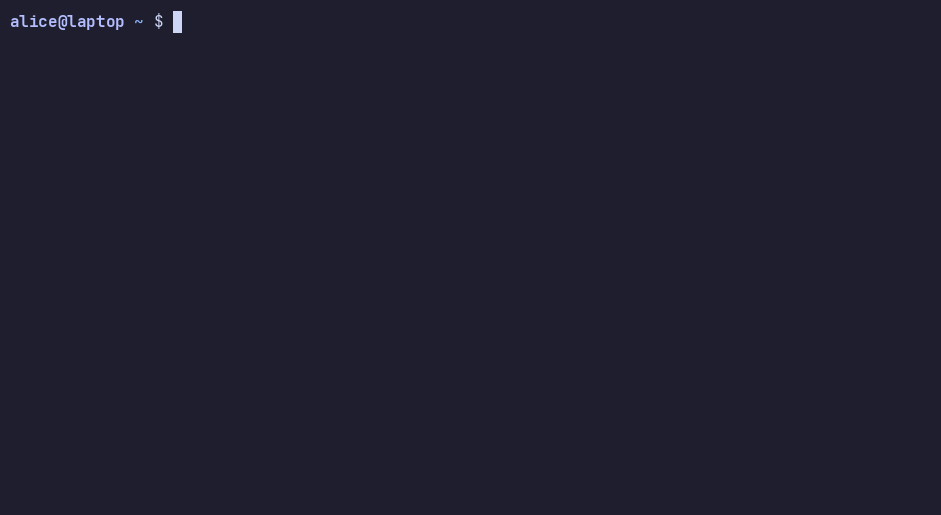
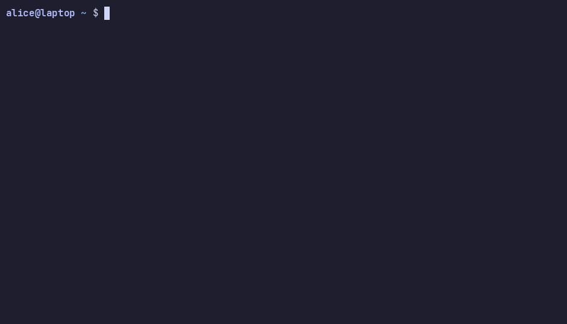

<p align="center">
  <picture>
    <source media="(prefers-color-scheme: dark)" srcset="assets/logo/appzones-dark.svg">
    
  </picture>
</p>

<p align="center"><b>Long-lived sandboxes for your desktop apps, dev tools and AI agents on Linux.</b></p>

<p align="center">
  <a href="https://github.com/mirql/appzones/releases"></a>
  <a href="LICENSE"></a>
  <a href="#install"></a>
  <a href="docs/getting-started/install.md"></a>
  <br>
  <a href="https://github.com/mirql/appzones/stargazers"></a>
  <a href="https://github.com/mirql/appzones/commits/main"></a>
  <a href="https://github.com/mirql/appzones/graphs/commit-activity"></a>
  <a href="https://coderabbit.ai"></a>
  <a href="https://sonarcloud.io/summary/overall?id=mirql_appzones"></a>
  <a href="https://sonarcloud.io/summary/overall?id=mirql_appzones"></a>
  <a href="CONTRIBUTING.md"></a>
  <!-- ALL-CONTRIBUTORS-BADGE:START - Do not remove or modify this section -->
<a href="#contributors"></a>
<!-- ALL-CONTRIBUTORS-BADGE:END -->
</p>

> *I wanted my desktop split into **separate, sealed-off spaces**: a browser
> for each kind of work, and a clean home for every AI tool with its own
> configs. A VM or a container for each felt like **far too much**, so I built
> something **lighter**.*
>
> — **Askar**, author of appzones

An app zone is a place your apps live in: `daily` for messengers, `work`
for Slack and the work browser, `untrusted` for links you don't trust,
`dev` for `npm install`. Each zone has its own home, its own network rules
and its own window border colour. You declare them in one TOML file; they
run as systemd user units.

<p align="center">
  <picture>
    <source media="(prefers-color-scheme: dark)" srcset="assets/concept/concept-dark.svg">
    
  </picture>
</p>

```bash
appzones run daily firefox        # start the zone if needed, launch Firefox in it
appzones run dev -- kitty         # any command
appzones shell untrusted          # a shell inside
appzones mount dev ~/src/thing    # share a folder with a running zone, until umount
appzones list                     # zones, state, network, devices, apps running
```

> [!NOTE]
> appzones is young (0.5) and runs on **x86_64 NixOS** with a Wayland
> compositor. Window borders and tags per zone need Hyprland.

## Why

Everything you run on Linux runs as you. A browser exploit, a malicious
`postinstall` script, or an AI agent that runs the wrong command can read
`~/.ssh`, your cloud credentials, your other projects and your password
store, and reach every device on your LAN.

appzones puts a wall between those things, without a VM per app:

- **Your host stays clean.** Package managers, agent CLIs, prebuilt binaries
  and their caches live in a zone's home, not yours.
- **Zones, not per-app profiles.** Group apps the way you work. One TOML
  file, validated before anything starts.
- **Your apps, as they are.** A zone runs the host's own apps from the Nix
  store: no second runtime, no repackaging.
- **You can see where a window lives.** Each zone's windows carry its
  border colour, set from the process's cgroup, which the app can't fake.



<sub>Recorded in a NixOS VM by <code>just demo</code> (<a href="tests/demo.nix">tests/demo.nix</a>): the commands and their output are real, the yellow lines are narration. The LAN and "the internet" are a second VM.</sub>

## Recipes

### An isolated browser

```toml
[zones.untrusted]
colour  = "#f38ba8"
dns     = "public"   # no internal names, no LAN
links   = "zone"     # links clicked here open in this zone's browser
devices = ["gpu"]    # no sound, no mic, no camera, no screen sharing

[apps.firefox]
command = ["firefox"]
zones   = ["untrusted"]
args    = { untrusted = ["--private-window"] }
```

`appzones run untrusted firefox`, or "Firefox (untrusted)" in your launcher.

### Package managers off the host

Keep `npm`, `pip`, `cargo` and their install scripts away from your real
home:

```toml
[zones.dev]
colour   = "#f9e2af"
binds    = [{ path = "~/src/my-app", mode = "rw" }]
packages = ["nodejs", "python3", "uv"]  # nixpkgs attributes, on PATH in the zone
nix_ld   = true                         # prebuilt binaries from npm and pip run
tmp      = "disk"                       # /tmp survives restarts
```

```bash
appzones run dev -- kitty -e tmux new -As dev   # a terminal + tmux session inside
# then, inside: npm install, npm run dev, pip install ...
```

The tmux server, `~/.npm`, `~/.cache` and every install script stay inside
`dev`. The host never runs `npm`.

### AI agents in a zone

Give an agent one project and nothing else:

```toml
[zones.agents]
colour   = "#cba6f7"
binds    = [{ path = "~/src/my-app", mode = "rw" }]
packages = ["nodejs", "git"]
nix_ld   = true
```

```bash
appzones run agents -- kitty     # install and log in to your agent CLI in there
```

The agent's login, its tokens and its history stay in the zone's home. It
can't read `~/.ssh` or your other projects, has no `SSH_AUTH_SOCK`, and
can't reach your LAN or the host's own services.


> [!CAUTION]
> A **writable** bind is writable from the zone: it can change anything in
> that folder, including files your host runs later, such as `.git/hooks`,
> `.envrc`, `Makefile` and `package.json` scripts. Review what comes out of
> a zone before you run it on the host, or bind read-only and copy results
> out.

### Everyday apps, kept apart

```toml
[zones.work]
colour  = "#89b4fa"
devices = ["gpu", "audio", "mic", "screencast"]

[apps.slack]
command = ["slack"]
zones   = ["work"]
```

Every app in `[apps]` gets a launcher entry per zone ("Slack (work)"). Logins
and data of one zone never reach another.

### Opening a file you don't trust

```bash
appzones up untrusted                              # a mount needs a running zone
appzones mount untrusted ~/Downloads --ro --as dl
appzones run untrusted -- evince /mnt/host/dl/invoice.pdf
appzones umount untrusted dl
```



> [!TIP]
> `appzones new NAME` prints a safe zone block, and `-y` appends it to your
> config. `appzones check --probe ZONE` runs isolation probes inside a zone.

<details>
<summary><b>How it works</b></summary>

Built from parts that already exist, with no daemon and no setuid binary of
its own:

- **bubblewrap**: user, pid, ipc, uts and cgroup namespaces; no
  capabilities; `no_new_privs`; a fresh home and a curated `/etc`.
- **pasta + nftables**: its own network namespace with a deny list loaded
  inside it. The host's own addresses, its LANs (IPv4 and IPv6), loopback,
  tailnets and link-local are refused; the internet is reachable.
- **xdg-dbus-proxy**: a filtered session bus. Portals (file chooser, links,
  notifications, screen sharing) work; systemd, secrets and the host's file
  daemons don't.
- **wp_security_context_v1**: the compositor hides screencopy, clipboard
  managers, virtual input and global shortcuts from zone clients.
- **Hyprland** (optional): zone windows get the zone's border colour and a
  `zone:NAME` tag, from the process's cgroup.

</details>

<details>
<summary><b>How it compares</b>: Flatpak, Firejail, Qubes OS, Distrobox</summary>

| | appzones | Flatpak | Firejail | Qubes OS | Distrobox / Toolbx |
|---|---|---|---|---|---|
| You group apps by | trust (a zone per area of your life) | app | app | VM | container (not a boundary) |
| Apps come from | the host's own Nix store | Flathub, packaged for it | your system | each VM's OS | the container's distro |
| Network | internet yes; LAN, host and tailnet no | on or off | on, off or a filter | per-VM firewall | the host's |
| Which zone is this window? | border colour, the app can't fake it | no | no | border colour | no |
| Isolation | namespaces, same kernel | namespaces, same kernel | namespaces, same kernel, setuid binary | separate VMs (much stronger) | almost none |
| Runs on | your NixOS desktop | any distro | any distro | Qubes only | any distro |

appzones is for when Flatpak is too fine-grained, Qubes is too much, and
you want your messenger, your work browser, your agents and that PDF in
separate, labelled boxes on the desktop you already have.

</details>

## Install

NixOS with flakes:

```nix
# flake.nix
inputs.appzones.url = "github:mirql/appzones";
inputs.appzones.inputs.nixpkgs.follows = "nixpkgs";

# configuration.nix
imports = [ inputs.appzones.nixosModules.default ];
programs.appzones = {
  enable = true;
  user = "alice";
  deniedPaths = [ "~/src/secret-project" ];  # never in any zone, on top of ~/.ssh & co.
};
```

Then copy [`examples/minimal.toml`](examples/minimal.toml) to
`~/.config/appzones/zones.toml` (or run `appzones new daily -y`) and run
`appzones check`.

> [!IMPORTANT]
> A system switch can stop zones that are running. Close what runs in your
> zones before you switch.

<details>
<summary><b>Set up with an AI agent</b>: a prompt to paste into Claude Code, Codex, opencode, ...</summary>

```markdown
# Set up appzones

Set up **appzones** on this NixOS machine: <https://github.com/mirql/appzones>
(long-lived sandboxes for desktop apps). Read its `README.md` and the docs
first: [install](https://raw.githubusercontent.com/mirql/appzones/main/docs/getting-started/install.md),
[configuration reference](https://raw.githubusercontent.com/mirql/appzones/main/docs/configuration/reference.md),
[desktop](https://raw.githubusercontent.com/mirql/appzones/main/docs/desktop.md) (raw markdown; the site is https://mirql.github.io/appzones/).

1. **Check first**, and tell me what you find before changing anything:
   - x86_64 NixOS configured with flakes (find my flake and this host's config);
   - a Wayland compositor with `wp_security_context_v1` (Hyprland, sway, KWin, ...);
     window borders and tags per zone need Hyprland;
   - unprivileged user namespaces, `xdg-desktop-portal`, PipeWire;
   - an nftables firewall, or the kernel modules in the install page's "Kernel modules".
2. **Add the flake input** `appzones` (`github:mirql/appzones`, with
   `inputs.nixpkgs.follows = "nixpkgs"`), import `appzones.nixosModules.default`,
   and set `programs.appzones.enable = true` and `programs.appzones.user` to my user.
3. **Ask me which folders must never enter a zone** (code checkouts, secret
   stores, other disks) and put them in `programs.appzones.deniedPaths`
   (absolute, or `~/...`). If I use NetBird, set `netbirdInterface` (default `wt0`).
4. **Ask me which zones and apps I want** (for example `daily`, `work`, `untrusted`).
   Write `~/.config/appzones/zones.toml` starting from `examples/minimal.toml` (or
   put it where my dotfiles manage `~/.config`). Add binds only for folders I
   name; never my whole home, `~/.ssh`, or a folder where programs keep sockets.
5. **Optional:** if I use Hyprland, load `contrib/hyprland/appzones.lua` from my
   Hyprland config; if I use Waybar, add the custom module from the desktop page.
6. **Build without switching** (`nixos-rebuild build --flake .#<host>`), then run
   `./result/sw/bin/appzones check`. Show me what you changed and what it reports.
7. **Do not switch yourself.** Give me the switch command, and tell me that a
   switch can stop zones that are running.
8. **After I switch:** `appzones list`, then `appzones run <zone> <app>`.
```

</details>

### Use it with your AI agent

The [appzones skill](skills/appzones/SKILL.md) teaches a coding agent
(Claude Code, Codex, opencode, Cursor, ...) to run things in your zones, add
zones and apps, share folders, and debug what doesn't work inside one. It
asks before stopping a zone and never weakens isolation on its own.

```bash
npx skills add mirql/appzones
```

Or copy `skills/appzones/SKILL.md` into your agent's skills folder.

## Limits

> [!WARNING]
> Zones share your uid and your kernel: a kernel bug reachable from inside
> escapes everything. A compromised app can still read everything in its own
> zone, draw windows that look like anything (learn your border colours),
> and use the internet as you. X11-only apps don't run yet.
> See [Security and limits](docs/security.md) in the docs.

## Docs

- [Docs](https://mirql.github.io/appzones/) ([in the repo](docs/guide.md)): install, recipes, every `zones.toml`
  key, D-Bus, USB devices, runtime mounts, troubleshooting, how a zone is built.
- [examples/minimal.toml](examples/minimal.toml): a first config that works anywhere.
- [examples/zones.toml](examples/zones.toml): every key, commented.

## Development

```bash
nix develop
just test        # unit tests (fast, no Nix)
just build       # the package; runs the unit tests too
just test-vm     # NixOS VM test with Hyprland (~6 min, needs /dev/kvm)
```

See [CONTRIBUTING.md](CONTRIBUTING.md). Found a way out of a zone? Please
report it privately: [SECURITY.md](SECURITY.md).

## Contributing

Issues, ideas and PRs are welcome. Good places to start:

- **Other compositors.** Only Hyprland gets window tags and border
  colours. Sway, niri or KWin hooks would help.
- **Other distributions.** Only NixOS is packaged.
- **aarch64.** Nothing has been tried there yet.
- **Docs.** If something in the [docs](https://mirql.github.io/appzones/) was unclear to you,
  it will be to the next person too.

Questions go to [Discussions](https://github.com/mirql/appzones/discussions).

## Contributors

Thanks to everyone who made appzones what it is
([emoji key](https://allcontributors.org/docs/en/emoji-key)):

<!-- ALL-CONTRIBUTORS-LIST:START - Do not remove or modify this section -->
<!-- prettier-ignore-start -->
<!-- markdownlint-disable -->
<table>
  <tbody>
    <tr>
      <td align="center" valign="top" width="14.28%"><a href="https://github.com/askaramirov"><br /><sub><b>Askar Amirov</b></sub></a><br /><a href="https://github.com/mirql/appzones/commits?author=askaramirov" title="Code">💻</a> <a href="https://github.com/mirql/appzones/commits?author=askaramirov" title="Documentation">📖</a> <a href="#design-askaramirov" title="Design">🎨</a> <a href="https://github.com/mirql/appzones/commits?author=askaramirov" title="Tests">⚠️</a> <a href="#security-askaramirov" title="Security">🛡️</a> <a href="#infra-askaramirov" title="Infrastructure (Hosting, Build-Tools, etc)">🚇</a> <a href="#maintenance-askaramirov" title="Maintenance">🚧</a></td>
      <td align="center" valign="top" width="14.28%"><a href="https://github.com/Saifeldin-H"><br /><sub><b>Saif H</b></sub></a><br /><a href="https://github.com/mirql/appzones/commits?author=Saifeldin-H" title="Documentation">📖</a> <a href="#design-Saifeldin-H" title="Design">🎨</a></td>
    </tr>
  </tbody>
</table>

<!-- markdownlint-restore -->
<!-- prettier-ignore-end -->

<!-- ALL-CONTRIBUTORS-LIST:END -->

Helped in a way that isn't a commit? Comment on any issue or PR:
`@all-contributors please add @name for ideas, review` (and so on).

## License

[MIT](LICENSE)
