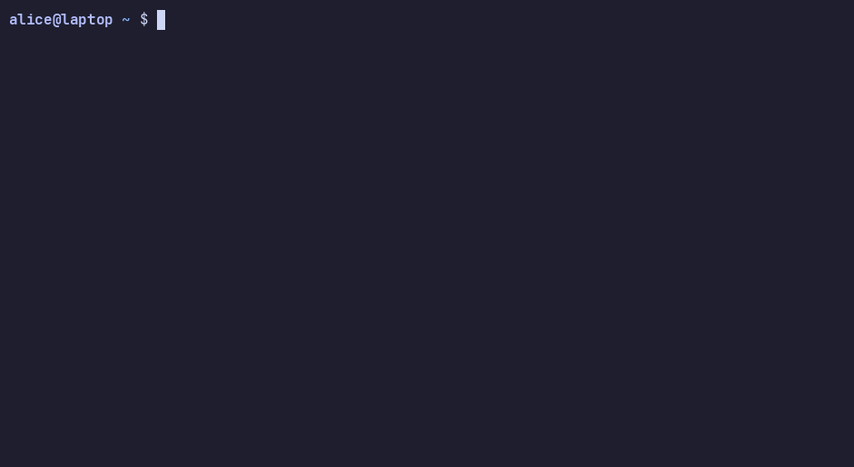

# appzones

**Long-lived sandboxes for your desktop apps, dev tools and AI agents on Linux.**
{: .fs-6 .fw-300 }

[Get started](getting-started.html){: .btn .btn-primary .mr-2 } [GitHub](https://github.com/mirql/appzones){: .btn }

[](https://github.com/mirql/appzones/releases)
[](https://github.com/mirql/appzones/blob/main/LICENSE)
[](#install)
[](https://github.com/mirql/appzones/stargazers)
[](https://sonarcloud.io/summary/overall?id=mirql_appzones)
[](https://sonarcloud.io/summary/overall?id=mirql_appzones)
[](https://github.com/mirql/appzones/blob/main/CONTRIBUTING.md)
{: .badges }

An app zone is a place your apps live in: `daily` for messengers, `work` for
Slack and the work browser, `untrusted` for links you don't trust, `dev` for
`npm install`, `agents` for an AI agent with one project. Each zone has its
own home, its own network rules and its own window border colour. You declare
them in one TOML file; they run as systemd user units.



```bash
appzones run daily firefox        # start the zone if needed, launch Firefox in it
appzones shell untrusted          # a shell inside
appzones mount dev ~/src/thing    # share a folder with a running zone, until umount
appzones list                     # zones, state, network, devices, apps running
```



## Install

NixOS with flakes (x86_64, a Wayland compositor with `wp_security_context_v1`;
window borders need Hyprland):

```nix
inputs.appzones.url = "github:mirql/appzones";
imports = [ inputs.appzones.nixosModules.default ];
programs.appzones.enable = true;
```

Then `appzones new daily -y` and `appzones check`. The [install page](getting-started/install.html)
has the details; [recipes](recipes.html) show what zones are good for.

## More

- [The README](https://github.com/mirql/appzones#readme): recipes for browsers, package managers and AI agents, and how appzones compares.
- [The agent skill](https://github.com/mirql/appzones/blob/main/skills/appzones/SKILL.md): `npx skills add mirql/appzones` teaches your coding agent to use appzones.
- [Discussions](https://github.com/mirql/appzones/discussions) for questions and ideas; [good first issues](https://github.com/mirql/appzones/labels/good%20first%20issue) to help.
- Found a way out of a zone? [Report it privately](https://github.com/mirql/appzones/security/advisories/new).
