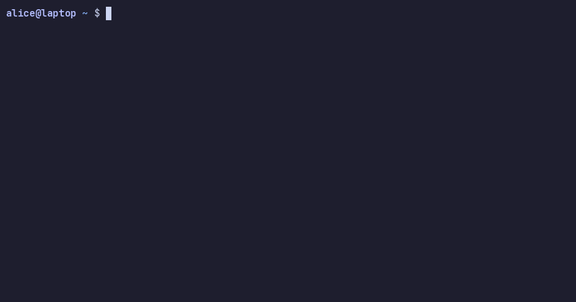

# Recipes

## An isolated browser

```toml
[zones.untrusted]
colour  = "#f38ba8"
dns     = "public"   # no internal names, no LAN
links   = "zone"     # links clicked here open in this zone's browser
devices = ["gpu"]    # no sound, no mic, no camera, no screen sharing

[apps.firefox]
command = ["firefox"]
zones   = ["untrusted"]
args    = { untrusted = ["--private-window"] }
```

`appzones run untrusted firefox`, or "Firefox (untrusted)" in your launcher.

## Package managers off the host

Keep `npm`, `pip`, `cargo` and their install scripts away from your real
home:

```toml
[zones.dev]
colour   = "#f9e2af"
binds    = [{ path = "~/src/my-app", mode = "rw" }]
packages = ["nodejs", "python3", "uv"]  # nixpkgs attributes, on PATH in the zone
nix_ld   = true                         # prebuilt binaries from npm and pip run
tmp      = "disk"                       # /tmp survives restarts
```

```bash
appzones run dev -- kitty -e tmux new -As dev   # a terminal + tmux session inside
# then, inside: npm install, npm run dev, pip install ...
```

The tmux server, `~/.npm`, `~/.cache` and every install script stay inside
`dev`. The host never runs `npm`.

## AI agents in a zone

Give an agent one project and nothing else:

```toml
[zones.agents]
colour   = "#cba6f7"
binds    = [{ path = "~/src/my-app", mode = "rw" }]
packages = ["nodejs", "git"]
nix_ld   = true
```

```bash
appzones run agents -- kitty     # install and log in to your agent CLI in there
```

The agent's login, its tokens and its history stay in the zone's home. It
can't read `~/.ssh` or your other projects, has no `SSH_AUTH_SOCK`, and
can't reach your LAN or the host's own services.



> **Caution:** A **writable** bind is writable from the zone: it can change anything in
> that folder, including files your host runs later, such as `.git/hooks`,
> `.envrc`, `Makefile` and `package.json` scripts. Review what comes out of
> a zone before you run it on the host, or bind read-only and copy results
> out.

## Everyday apps, kept apart

```toml
[zones.work]
colour  = "#89b4fa"
devices = ["gpu", "audio", "mic", "screencast"]

[apps.slack]
command = ["slack"]
zones   = ["work"]
```

Every app in `[apps]` gets a launcher entry per zone ("Slack (work)"). Logins
and data of one zone never reach another.

## Opening a file you don't trust

```bash
appzones up untrusted                              # a mount needs a running zone
appzones mount untrusted ~/Downloads --ro --as dl
appzones run untrusted -- evince /mnt/host/dl/invoice.pdf
# ... read it; once Evince is closed:
appzones umount untrusted dl                       # detaches the mount; ~/Downloads stays as it is
```


> **Tip:** `appzones new NAME` prints a safe zone block, and `-y` appends it to your
> config. `appzones check --probe ZONE` runs isolation probes inside a zone.
